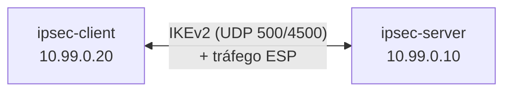

# Laboratório de VPN IPsec/IKEv2 com strongSwan e Docker Compose

**Autor:** _(seu nome)_ · **Disciplina:** _(disciplina)_ · **Instituição:** IFPB

Este tutorial documenta, passo a passo, como reproduzir um laboratório de VPN com **strongSwan**, em que dois hosts virtuais (cliente e servidor), executados em containers Docker, se comunicam de forma segura por meio de **IPsec**, com os parâmetros de segurança negociados pelo protocolo **IKEv2**.

## Sumário

1. [Objetivo](#1-objetivo)
2. [Conceitos básicos](#2-conceitos-básicos)
3. [Topologia](#3-topologia)
4. [Pré-requisitos](#4-pré-requisitos)
5. [Estrutura do projeto](#5-estrutura-do-projeto)
6. [Entendendo os arquivos](#6-entendendo-os-arquivos)
7. [Subindo o ambiente](#7-subindo-o-ambiente)
8. [Verificando o túnel](#8-verificando-o-túnel)
9. [Capturando e analisando o tráfego no Wireshark](#9-capturando-e-analisando-o-tráfego-no-wireshark)
10. [Autenticação por certificados (opcional)](#10-autenticação-por-certificados-opcional)
11. [Problemas comuns](#11-problemas-comuns)
12. [Encerrando o laboratório](#12-encerrando-o-laboratório)
13. [Conclusão](#13-conclusão)

---

## 1. Objetivo

- Criar, com Docker e Docker Compose, um ambiente com dois containers: **servidor** e **cliente** strongSwan.
- Estabelecer um túnel **IPsec** entre eles, com negociação via **IKEv2**.
- Comprovar que a comunicação ocorre dentro do túnel (**ESP**), comparando capturas de tráfego com e sem a VPN no Wireshark.

## 2. Conceitos básicos

| Termo | Descrição |
|---|---|
| **IPsec** | Conjunto de protocolos que protege o tráfego na camada de rede (IP). No Linux, a cifragem é feita pelo kernel (subsistema *xfrm*). |
| **IKEv2** | Protocolo de negociação do IPsec (UDP 500, e 4500 quando há NAT-T). Autentica os pares, troca chaves (Diffie-Hellman) e combina os algoritmos. |
| **SA** (*Security Association*) | Acordo entre os pares sobre algoritmos e chaves. A **IKE_SA** protege a própria negociação; a **CHILD_SA** protege os dados. |
| **ESP** | Protocolo IP 50 que cifra e autentica os pacotes de dados. Cada sentido da CHILD_SA tem um **SPI** próprio. |
| **Modo túnel** | O pacote original é encapsulado inteiro dentro de um novo pacote ESP. |
| **PSK** | *Pre-Shared Key*: segredo compartilhado usado na autenticação. Alternativa: certificados X.509 (seção 10). |
| **swanctl / charon** | `charon` é o daemon IKE do strongSwan; `swanctl` é a ferramenta de linha de comando para configurá-lo. |

A negociação IKEv2 acontece em duas trocas:

1. **IKE_SA_INIT** — escolhe os algoritmos e faz a troca Diffie-Hellman (em claro).
2. **IKE_AUTH** — autentica os pares e cria a primeira CHILD_SA (já cifrada).

## 3. Topologia



| Container | Hostname | IP | Papel |
|---|---|---|---|
| `ipsec-server` | server | 10.99.0.10 | Responde à negociação IKEv2 |
| `ipsec-client` | client | 10.99.0.20 | Inicia o túnel ao subir |

Rede Docker `vpnnet`: `10.99.0.0/24` (bridge).

> Se essa faixa já estiver em uso no seu computador (erro *"Pool overlaps with other one on this address space"*), veja a [seção 11](#11-problemas-comuns).

## 4. Pré-requisitos

- Linux com **Docker** e **Docker Compose v2** (`docker compose version`).
- Kernel do host com suporte a IPsec/ESP (módulos `esp4` e `xfrm_user`, presentes na maioria das distribuições).
- **Wireshark** para analisar as capturas.
- Docker Desktop (Windows/macOS) e WSL2 costumam **não** ter suporte a ESP; use uma máquina Linux ou VM Linux.

## 5. Estrutura do projeto

```
strongswan-lab/
├── Dockerfile              # imagem única (Debian 12 + strongSwan), usada pelos dois containers
├── docker-compose.yml      # define os containers e a rede
├── entrypoint.sh           # escolhe a configuração por ROLE e AUTH_MODE e inicia o charon
├── gen-certs.sh            # gera a CA e os certificados (modo cert)
├── conf/
│   ├── server-psk.conf     # servidor, autenticação por PSK
│   ├── client-psk.conf     # cliente, autenticação por PSK
│   ├── server-cert.conf    # servidor, autenticação por certificado
│   ├── client-cert.conf    # cliente, autenticação por certificado
│   └── logging.conf        # logs do charon na saída padrão
├── scripts/
│   ├── test.sh             # verifica SAs, ping e xfrm
│   ├── capture.sh          # captura tráfego enquanto o cliente faz ping
│   ├── compare.sh          # captura sem túnel e com túnel
│   └── handshake.sh        # captura o handshake IKEv2
├── certs/                  # certificados gerados (ignorados pelo git)
├── captures/               # arquivos .pcap
└── docs/img/               # prints usados neste tutorial
```

## 6. Entendendo os arquivos

### 6.1 Dockerfile

```dockerfile
FROM debian:12-slim

# strongSwan (daemon charon + swanctl + pki) e ferramentas de teste/captura
RUN apt-get update && apt-get install -y --no-install-recommends \
        strongswan-charon \
        strongswan-swanctl \
        strongswan-pki \
        libstrongswan-standard-plugins \
        iproute2 iputils-ping tcpdump ca-certificates \
    && rm -rf /var/lib/apt/lists/*

# Logs do charon na saida padrao (visiveis em "docker logs")
COPY conf/logging.conf /etc/strongswan.d/zz-lab-logging.conf

# Configuracoes (escolhidas em tempo de execucao por ROLE e AUTH_MODE)
COPY conf/ /conf/

COPY entrypoint.sh /usr/local/bin/entrypoint.sh
COPY gen-certs.sh  /usr/local/bin/gen-certs.sh
RUN chmod +x /usr/local/bin/entrypoint.sh /usr/local/bin/gen-certs.sh

# IKE (500/udp) e NAT-T (4500/udp); ESP e protocolo IP 50 (nao tem porta)
EXPOSE 500/udp 4500/udp

ENTRYPOINT ["/usr/local/bin/entrypoint.sh"]
```

- Instala o daemon `charon`, o `swanctl`, a ferramenta `pki` e os plugins padrão de criptografia.
- `iproute2`, `iputils-ping` e `tcpdump` servem para testes e capturas.
- Uma só imagem atende servidor e cliente; o papel é definido por variável de ambiente.

### 6.2 docker-compose.yml

```yaml
name: strongswan-lab

services:
  server:
    build: .
    image: strongswan-lab:latest
    container_name: ipsec-server
    hostname: server
    environment:
      ROLE: server
      AUTH_MODE: ${AUTH_MODE:-psk}      # psk (padrao) ou cert
    cap_add: [NET_ADMIN, NET_RAW]       # necessario para o kernel IPsec (xfrm)
    volumes:
      - ./certs:/certs:ro
      - ./captures:/captures            # pcaps para abrir no Wireshark
    networks:
      vpnnet:
        ipv4_address: 10.99.0.10

  client:
    build: .
    image: strongswan-lab:latest
    container_name: ipsec-client
    hostname: client
    environment:
      ROLE: client
      AUTH_MODE: ${AUTH_MODE:-psk}
    cap_add: [NET_ADMIN, NET_RAW]
    volumes:
      - ./certs:/certs:ro
    depends_on: [server]
    networks:
      vpnnet:
        ipv4_address: 10.99.0.20

  # Ferramenta: gera CA e certificados  ->  docker compose --profile tools run --rm certgen
  certgen:
    profiles: [tools]
    image: strongswan-lab:latest
    build: .
    entrypoint: ["/usr/local/bin/gen-certs.sh"]
    volumes:
      - ./certs:/certs
    network_mode: none

networks:
  vpnnet:
    driver: bridge
    ipam:
      config:
        - subnet: 10.99.0.0/24
```

- `cap_add: [NET_ADMIN, NET_RAW]` é necessário para o strongSwan programar o kernel (SAs e políticas IPsec).
- `AUTH_MODE` seleciona `psk` (padrão) ou `cert`.
- `./captures` é montado no servidor para que os `.pcap` apareçam no host.
- O serviço `certgen` só roda sob demanda (`--profile tools`).

### 6.3 entrypoint.sh

```bash
#!/bin/bash
# Prepara a configuracao do strongSwan conforme o papel (server|client)
# e o modo de autenticacao (psk|cert), e inicia o daemon charon em primeiro plano.
set -euo pipefail

ROLE="${ROLE:?defina ROLE=server ou ROLE=client}"
AUTH_MODE="${AUTH_MODE:-psk}"
CONF="/conf/${ROLE}-${AUTH_MODE}.conf"

[ -f "$CONF" ] || { echo "[lab] ERRO: $CONF nao existe (ROLE/AUTH_MODE invalidos)"; exit 1; }
echo "[lab] papel=${ROLE} autenticacao=${AUTH_MODE}"

install -D -m 600 "$CONF" /etc/swanctl/swanctl.conf

if [ "$AUTH_MODE" = "cert" ]; then
    for f in ca.crt "${ROLE}.crt" "${ROLE}.key"; do
        [ -f "/certs/$f" ] || { echo "[lab] ERRO: /certs/$f ausente. Rode ./gen-certs.sh antes."; exit 1; }
    done
    install -D -m 644 /certs/ca.crt        /etc/swanctl/x509ca/ca.crt
    install -D -m 644 "/certs/${ROLE}.crt" "/etc/swanctl/x509/${ROLE}.crt"
    install -D -m 600 "/certs/${ROLE}.key" "/etc/swanctl/private/${ROLE}.key"
fi

# Em segundo plano: espera o socket VICI do charon e carrega conexoes/credenciais
(
    for _ in $(seq 1 30); do
        [ -S /var/run/charon.vici ] && break
        sleep 1
    done
    swanctl --load-all
) &

# charon como PID 1 (recebe SIGTERM do "docker stop")
exec /usr/lib/ipsec/charon
```

- Copia a configuração correta para `/etc/swanctl/swanctl.conf`.
- Em segundo plano, aguarda o socket VICI do charon e executa `swanctl --load-all`.
- O `charon` roda em primeiro plano como PID 1, com logs visíveis em `docker logs`.

### 6.4 Configuração do servidor (PSK)

```
connections {
    lab {
        version = 2                          # IKEv2
        local_addrs  = 10.99.0.10
        remote_addrs = 10.99.0.20
        proposals = aes256-sha256-modp2048   # IKE_SA: cifra-integridade-grupo DH

        local {
            auth = psk
            id = server.lab
        }

        remote {
            auth = psk
            id = client.lab
        }

        children {
            lab-tunnel {
                local_ts  = 10.99.0.10/32
                remote_ts = 10.99.0.20/32
                esp_proposals = aes256-sha256-modp2048   # CHILD_SA (ESP)
                mode = tunnel
                start_action = none          # o servidor espera o cliente iniciar
            }
        }
    }
}

secrets {
    ike-lab {
        id-1 = server.lab
        id-2 = client.lab
        secret = "LabIPsec@IFPB-2026"
    }
}
```

| Parâmetro | Significado |
|---|---|
| `version = 2` | Usa IKEv2 |
| `local_addrs` / `remote_addrs` | Endereços dos dois pares |
| `proposals` | Algoritmos da IKE_SA: AES-256, SHA-256 e grupo Diffie-Hellman MODP-2048 |
| `local` / `remote` | Autenticação e identidade (`id`) de cada lado |
| `local_ts` / `remote_ts` | *Traffic selectors*: quais pacotes entram no túnel |
| `esp_proposals` | Algoritmos da CHILD_SA (ESP) |
| `mode = tunnel` | Modo túnel |
| `start_action` | `none` no servidor (espera); `start` no cliente (inicia sozinho) |
| `secrets` | A chave pré-compartilhada (PSK) |

### 6.5 Configuração do cliente (PSK)

```
connections {
    lab {
        version = 2
        local_addrs  = 10.99.0.20
        remote_addrs = 10.99.0.10
        proposals = aes256-sha256-modp2048

        local {
            auth = psk
            id = client.lab
        }

        remote {
            auth = psk
            id = server.lab
        }

        children {
            lab-tunnel {
                local_ts  = 10.99.0.20/32
                remote_ts = 10.99.0.10/32
                esp_proposals = aes256-sha256-modp2048
                mode = tunnel
                start_action = start         # o cliente inicia o tunel ao subir
            }
        }
    }
}

secrets {
    ike-lab {
        id-1 = client.lab
        id-2 = server.lab
        secret = "LabIPsec@IFPB-2026"
    }
}
```

É o espelho da configuração do servidor: endereços, `id` e *traffic selectors* invertidos, e `start_action = start`.

> **Aviso:** a PSK `LabIPsec@IFPB-2026` é uma chave de **teste**, publicada neste repositório apenas para fins didáticos. Nunca use uma chave como esta em ambientes reais.

## 7. Subindo o ambiente

```bash
git clone https://github.com/SEU_USUARIO/strongswan-lab.git
cd strongswan-lab
docker compose up -d --build
docker compose ps
```

Os dois containers (`ipsec-server` e `ipsec-client`) devem aparecer como *running*. Acompanhe a negociação nos logs do cliente:

```bash
docker logs ipsec-client
```

## 8. Verificando o túnel

```bash
./scripts/test.sh
```

Esse script executa quatro verificações. Resultado obtido neste laboratório:

**1) SAs no cliente (`swanctl --list-sas`)**

```
lab: #1, ESTABLISHED, IKEv2, e8de80362721a555_i* d9dbfcf8c619a970_r
  local  'client.lab' @ 10.99.0.20[4500]
  remote 'server.lab' @ 10.99.0.10[4500]
  AES_CBC-256/HMAC_SHA2_256_128/PRF_HMAC_SHA2_256/MODP_2048
  established 19s ago, rekeying in 14116s
  lab-tunnel: #1, reqid 1, INSTALLED, TUNNEL, ESP:AES_CBC-256/HMAC_SHA2_256_128
    installed 19s ago, rekeying in 3416s, expires in 3941s
    in  cc28e15e,      0 bytes,     0 packets
    out cbb107a2,      0 bytes,     0 packets
    local  10.99.0.20/32
    remote 10.99.0.10/32
```

- `ESTABLISHED, IKEv2`: a IKE_SA foi estabelecida com os algoritmos configurados.
- `INSTALLED, TUNNEL, ESP`: a CHILD_SA foi instalada no kernel em modo túnel.
- Os contadores estão zerados porque a listagem rodou **antes** do ping.

**2) Ping do cliente para o servidor**

```
64 bytes from 10.99.0.10: icmp_seq=1 ttl=64 time=0.097 ms
...
4 packets transmitted, 4 received, 0% packet loss
```

**3) SAs ESP no kernel do servidor (`ip xfrm state`)**

```
src 10.99.0.10 dst 10.99.0.20
	proto esp spi 0xcc28e15e reqid 1 mode tunnel
	auth-trunc hmac(sha256) ... 128
	enc cbc(aes) ...
	anti-replay context: seq 0x0, oseq 0x4, bitmap 0x00000000
src 10.99.0.20 dst 10.99.0.10
	proto esp spi 0xcbb107a2 reqid 1 mode tunnel
	anti-replay context: seq 0x4, oseq 0x0, bitmap 0x0000000f
```

Os contadores `oseq 0x4` (saída) e `seq 0x4` (entrada) mostram que os **4 pacotes do ping passaram pelo ESP**. As chaves foram omitidas (`...`).

**4) Políticas xfrm (`ip xfrm policy`)**

As entradas `dir out`, `dir in` e `dir fwd` com `proto esp` indicam que o kernel força o tráfego entre `10.99.0.10/32` e `10.99.0.20/32` pelo túnel. As linhas `socket in/out` são políticas de *bypass* criadas pelo strongSwan para o próprio tráfego IKE.

## 9. Capturando e analisando o tráfego no Wireshark

### 9.1 Comparação sem túnel × com túnel

```bash
./scripts/compare.sh
```

O script:

1. Derruba a IKE_SA do cliente (`swanctl --terminate`).
2. Captura 8 s no servidor enquanto o cliente faz ping, gerando `captures/sem-tunel.pcap`.
3. Reestabelece o túnel (`swanctl --initiate`).
4. Repete a captura, gerando `captures/com-tunel.pcap`.

O ping funciona nos dois casos, mas só no segundo o conteúdo está protegido.

### 9.2 Handshake IKEv2

```bash
./scripts/handshake.sh
```

Gera `captures/handshake-ikev2.pcap`, capturando a negociação completa.

### 9.3 O que observar no Wireshark

| Arquivo | Filtro | O que deve aparecer |
|---|---|---|
| `sem-tunel.pcap` | `icmp` | *Echo request/reply* legíveis, com IPs e conteúdo visíveis |
| `com-tunel.pcap` | `esp` | Pacotes ESP com SPI visível e conteúdo ilegível, sem nenhum ICMP |
| `handshake-ikev2.pcap` | `isakmp` | `IKE_SA_INIT` (request/response) e `IKE_AUTH` (request/response) |

> Se `esp` não retornar pacotes, tente `udp.port == 4500`. Com NAT-T ativo, o ESP viaja encapsulado em UDP 4500.

### 9.4 Resultado: handshake IKEv2

Captura completa (8 pacotes). Os 4 últimos são ARP, resolução de MAC entre os containers, sem relação com o IPsec:


Com o filtro `isakmp`, restam os 4 pacotes do handshake:


| Nº | Origem → destino | Mensagem | Tamanho |
|---|---|---|---|
| 1 | 10.99.0.20 → 10.99.0.10 | `IKE_SA_INIT` (request) | 506 bytes |
| 2 | 10.99.0.10 → 10.99.0.20 | `IKE_SA_INIT` (response) | 514 bytes |
| 3 | 10.99.0.20 → 10.99.0.10 | `IKE_AUTH` (request) | 334 bytes |
| 4 | 10.99.0.10 → 10.99.0.20 | `IKE_AUTH` (response) | 286 bytes |

Os tamanhos incluem os cabeçalhos Ethernet, IP e UDP (42 bytes) e, no `IKE_AUTH`, mais 4 bytes do marcador *non-ESP* da porta 4500. Descontando isso, correspondem às mensagens de 464, 472, 288 e 240 bytes registradas no log do strongSwan.

Log da negociação (cliente):

```
[IKE] initiating IKE_SA lab[3] to 10.99.0.10
[ENC] generating IKE_SA_INIT request 0 [ SA KE No N(NATD_S_IP) N(NATD_D_IP) ... ]
[NET] sending packet: from 10.99.0.20[500] to 10.99.0.10[500] (464 bytes)
[NET] received packet: from 10.99.0.10[500] to 10.99.0.20[500] (472 bytes)
[CFG] selected proposal: IKE:AES_CBC_256/HMAC_SHA2_256_128/PRF_HMAC_SHA2_256/MODP_2048
[IKE] authentication of 'client.lab' (myself) with pre-shared key
[ENC] generating IKE_AUTH request 1 [ IDi N(INIT_CONTACT) IDr AUTH SA TSi TSr ... ]
[NET] sending packet: from 10.99.0.20[4500] to 10.99.0.10[4500] (288 bytes)
[NET] received packet: from 10.99.0.10[4500] to 10.99.0.20[4500] (240 bytes)
[IKE] authentication of 'server.lab' with pre-shared key successful
[IKE] IKE_SA lab[3] established between 10.99.0.20[client.lab]...10.99.0.10[server.lab]
[CFG] selected proposal: ESP:AES_CBC_256/HMAC_SHA2_256_128/NO_EXT_SEQ
[IKE] CHILD_SA lab-tunnel{3} established with SPIs c18b8bb7_i c31c16b6_o and TS 10.99.0.20/32 === 10.99.0.10/32
```

Observações:

- O `IKE_SA_INIT` usa a porta **500**. A partir do `IKE_AUTH`, a negociação passa para a **4500**, o que indica que o strongSwan detectou NAT entre os pares (provavelmente por causa da bridge do Docker) e ativou o NAT-T.
- O `IKE_SA_INIT` é legível; o `IKE_AUTH` já é transmitido **cifrado** (*Encrypted and Authenticated*), protegido pelas chaves derivadas da troca Diffie-Hellman.
- Os SPIs mudam a cada negociação; para provar que um pacote ESP pertence ao túnel, compare o SPI do Wireshark com o log da mesma execução.

### 9.5 Prints complementares

<!-- Adicione aqui os prints abaixo (salve em docs/img/ e remova este comentário) -->

- _(print)_ Pacote 1 com a seção **Security Association** expandida: cifras propostas (AES-CBC, HMAC-SHA2-256, MODP-2048).
- _(print)_ Pacote 3 (`IKE_AUTH`) expandido: **Encrypted and Authenticated**.
- _(print)_ `sem-tunel.pcap` com filtro `icmp`: tráfego legível.
- _(print)_ `com-tunel.pcap` com filtro `esp`: SPI visível e payload ilegível.

## 10. Autenticação por certificados (opcional)

Em vez de PSK, os pares podem se autenticar com certificados X.509 assinados por uma CA do laboratório.

```bash
# 1) derrubar o ambiente atual
docker compose down

# 2) gerar CA, certificado do servidor e do cliente (pasta certs/)
docker compose --profile tools run --rm certgen

# 3) subir em modo cert
AUTH_MODE=cert docker compose up -d --build
./scripts/test.sh
```

Script de geração dos certificados (`gen-certs.sh`):

```bash
#!/bin/bash
# Gera a CA e os certificados do servidor e do cliente em /certs.
# Uso (no host):  docker compose --profile tools run --rm certgen
set -euo pipefail
cd /certs

echo "[pki] gerando CA..."
pki --gen --type rsa --size 3072 --outform pem > ca.key
pki --self --ca --lifetime 3650 --in ca.key \
    --dn "C=BR, O=IFPB, CN=IFPB Lab CA" --outform pem > ca.crt

gen() {   # gen <nome> <ip> <flag>
    echo "[pki] gerando certificado de $1..."
    pki --gen --type rsa --size 3072 --outform pem > "$1.key"
    pki --req --type priv --in "$1.key" \
        --dn "C=BR, O=IFPB, CN=$1.lab" --san "$1.lab" --san "$2" --outform pem \
      | pki --issue --type pkcs10 --cacert ca.crt --cakey ca.key --flag "$3" \
            --lifetime 1825 --outform pem > "$1.crt"
}
gen server 10.99.0.10 serverAuth
gen client 10.99.0.20 clientAuth

chmod 644 ca.crt server.crt client.crt
chmod 600 ca.key server.key client.key
echo "[pki] pronto:"; ls -l /certs/
```

Configuração do cliente no modo certificado:

```
connections {
    lab {
        version = 2
        local_addrs  = 10.99.0.20
        remote_addrs = 10.99.0.10
        proposals = aes256-sha256-modp2048

        local {
            auth = pubkey
            certs = client.crt
            id = client.lab
        }

        remote {
            auth = pubkey
            cacerts = ca.crt
            id = server.lab
        }

        children {
            lab-tunnel {
                local_ts  = 10.99.0.20/32
                remote_ts = 10.99.0.10/32
                esp_proposals = aes256-sha256-modp2048
                mode = tunnel
                start_action = start
            }
        }
    }
}
```

- `certs` indica o certificado próprio; `cacerts` indica a CA em que o par confia.
- Os certificados incluem o nome (`server.lab`, `client.lab`) e o IP no campo *SubjectAltName*.
- Se trocar a faixa de IPs do laboratório, **gere os certificados de novo** (os IPs ficam dentro deles).
- As chaves privadas ficam em `certs/` e **não** são versionadas (`.gitignore`).

## 11. Problemas comuns

| Sintoma | Causa provável | Solução |
|---|---|---|
| `Pool overlaps with other one on this address space` ao criar a rede | Outra rede Docker já usa `10.99.0.0/24` | Veja o comando abaixo para listar as redes e troque a faixa |
| `unable to install inbound and outbound IPsec SA` | O kernel do host não tem ESP | `sudo modprobe esp4 xfrm_user`; em Docker Desktop/WSL2, use uma VM Linux |
| `NO_PROPOSAL_CHOSEN` | `proposals`/`esp_proposals` diferentes entre os lados | Igualar as configurações |
| `AUTHENTICATION_FAILED` | PSK diferente ou `id` trocado | Conferir `secrets` e `id` nos dois arquivos |
| Linhas `plugin '...': failed to load` na saída do `swanctl` | Plugins opcionais não instalados na imagem | Inofensivo; os scripts já ocultam com `2>/dev/null` |
| `esp` sem resultados no Wireshark | ESP encapsulado em UDP 4500 (NAT-T) | Usar o filtro `udp.port == 4500` |

**Conflito de rede.** Para listar as redes Docker e suas faixas:

```bash
docker network inspect $(docker network ls -q) --format '{{.Name}}  {{range .IPAM.Config}}{{.Subnet}} {{end}}'
```

Para trocar a faixa (exemplo: de `10.99.0.` para `10.123.0.`), na pasta do projeto:

```bash
grep -rl "10\.99\.0\." . | xargs sed -i 's/10\.99\.0\./10.123.0./g'
```

## 12. Encerrando o laboratório

```bash
docker compose down            # remove containers e rede
docker compose down --rmi local   # remove também a imagem construída
```

## 13. Conclusão

O laboratório demonstrou uma VPN IPsec entre dois hosts virtuais com strongSwan:

- A negociação **IKEv2** estabeleceu a IKE_SA e a CHILD_SA com os algoritmos configurados (AES-256, SHA-256, MODP-2048).
- O kernel instalou as SAs ESP (`ip xfrm state`) e os contadores comprovaram que o tráfego passou pelo túnel.
- As capturas no Wireshark mostraram a diferença entre o tráfego em claro (ICMP) e protegido (ESP), além das mensagens do handshake IKEv2.
- O uso de Docker Compose torna o ambiente reproduzível: basta clonar o repositório e executar `docker compose up -d --build`.

## Referências

- Documentação do strongSwan: <https://docs.strongswan.org>
- RFC 7296 — Internet Key Exchange Protocol Version 2 (IKEv2)
- RFC 4303 — IP Encapsulating Security Payload (ESP)
